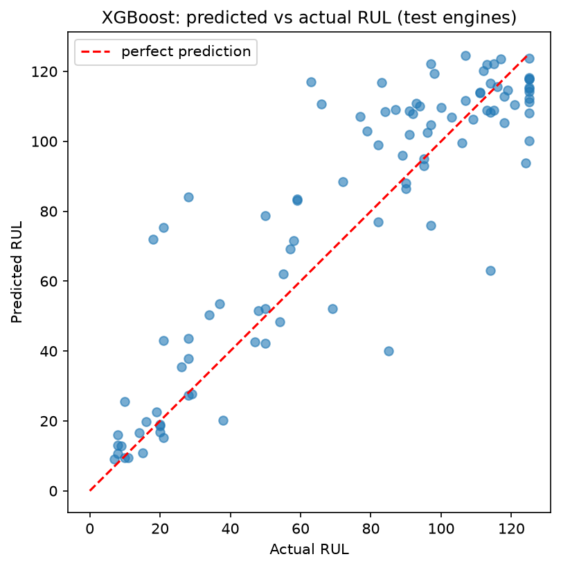
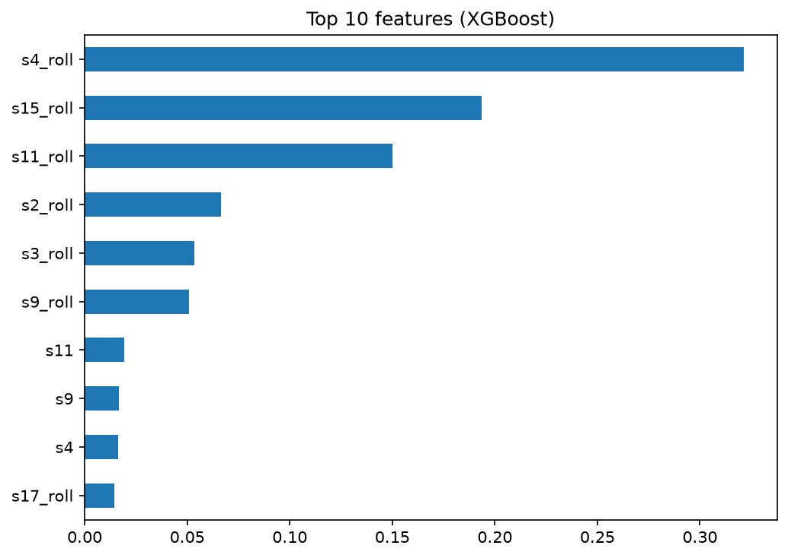

# Engine Remaining Useful Life (RUL) Prediction

Predictive maintenance for jet engines: estimating how many flight cycles an engine has left before failure, using NASA C-MAPSS sensor data.

## Problem
Servicing an engine too late is unsafe and costly; servicing too early wastes money. This project predicts Remaining Useful Life (RUL) from multivariate sensor readings so maintenance can be scheduled just in time.

## Dataset
NASA C-MAPSS turbofan engine simulation data, subset **FD001** (100 training engines run to failure, 100 test engines cut off before failure, plus true RUL values for the test engines). Each row is one flight cycle with 3 operating settings and 21 sensor readings.

## Approach
1. **Target:** RUL = (engine's last cycle) - (current cycle), capped at 125, since degradation is not observable early in an engine's life.
2. **Feature selection:** dropped 6 constant sensors (s1, s5, s10, s16, s18, s19) and the constant operating setting op3.
3. **Feature engineering:** 10-cycle rolling mean of each sensor, computed per engine to avoid leakage between engines.
4. **Validation:** 5-fold **GroupKFold split by engine**, so no engine appears in both training and validation.
5. **Models:** Linear Regression (baseline), Random Forest, XGBoost.
6. **Test evaluation:** predictions from the last recorded cycle of each test engine, compared with the official RUL file.

## Results (test set, 100 engines)

| Model | RMSE | MAE |
|-------|------|-----|
| Linear Regression | 20.78 | 16.35 |
| Random Forest | 20.51 | 14.11 |
| XGBoost | 18.61 | 13.16 |

XGBoost performed best on the official test set (RMSE 18.61). Engine-grouped cross-validation over all cycles gave a similar ranking of models, though it measures a slightly different task than the last-cycle test evaluation.

## Limitations and future work
- Only FD001 (single operating condition, single fault mode) was used.
- Only classical models were tried; sequence models such as LSTMs are a natural next step.
- The rolling window size and RUL cap could be tuned.

## How to run

    git clone https://github.com/Aishaa-S/engine-rul-prediction.git
    cd engine-rul-prediction
    pip install -r requirements.txt
    jupyter notebook rul_analysis.ipynb
